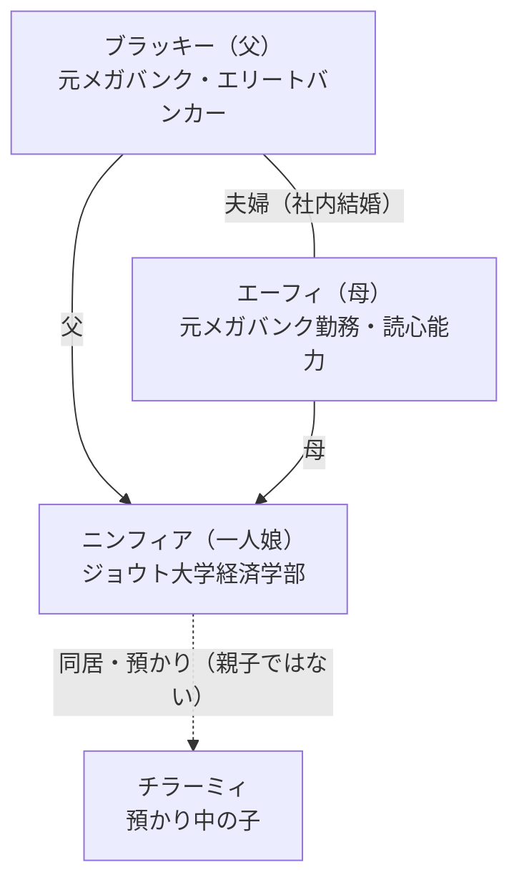
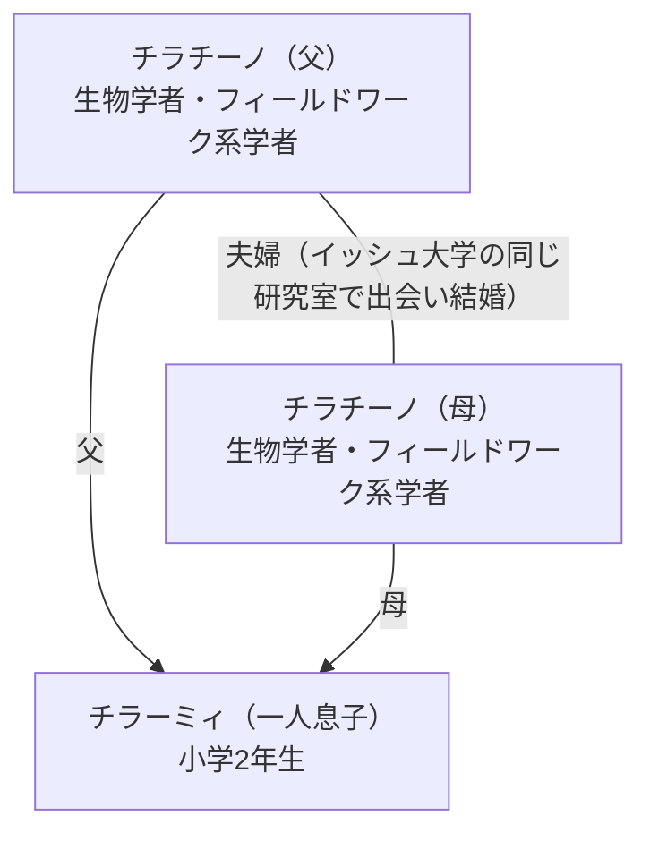
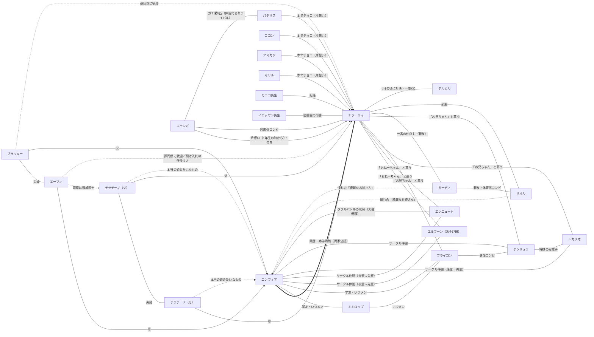

# 家系図・相関図

長編ロールプレイ小説（第01巻〜第06巻、ターン1〜135）の家系と主要キャラクターの相関を、資料ノート01〜06に基づいて整理した。

- 情報源は資料ノートのみ。曖昧な点は「（詳細不明）」とし、創作で補っていない。
- 記述が食い違う場合はより新しい巻の記述を優先した。特にニンフィアとチラーミィの血縁については注記を参照。

---

## 1. ニンフィアの家族（ブラッキー・エーフィ家）

### テキスト図

```
ブラッキー（父） ──── エーフィ（母）
種族:ブラッキー 種族:エーフィ
元メガバンクの 元メガバンク勤務
エリートバンカー （社内結婚）
│
│ 夫婦は今年の春に早期退職しFIRE達成
│ 新婚旅行先のビーチで同日に なつき進化
│ （昼:エーフィ／夜:ブラッキー）
│
└── ニンフィア（一人娘）
種族:ニンフィア（なつき進化）
ジョウト大学経済学部／20歳（第04巻）
高校時代、両親の布団に潜り込んで
泣きついた瞬間になつき進化
│
│ ※親子関係ではなく「同居・預かり」
└── チラーミィ（預かり中の子／同居人）
```

一家3人全員が なつき進化 であり、作中では「なつき進化一家」「あまえんぼ家系」と評された（第03巻ターン74）。

### Mermaid図



---

## 2. チラーミィの家族（チラチーノ家）

### テキスト図

```
チラチーノ（父） ──── チラチーノ（母）
生物学者・研究者 生物学者・研究者
ヒウン国際生物 ヒウン国際生物
科学研究所 科学研究所
│
│ 1636年創立のイッシュ大学の同じ研究室で
│ 出会って結婚。2人ともイッシュ大学入学時に
│ 進化の石を使って進化した
│
└── チラーミィ（一人息子）
小学2年生・8歳（人間換算、第05巻）
コガネ南小学校2年1組
両親のフィールドワーク不在中、
ニンフィアのワンルームに預けられ同居中
```

両親はフィールドワークで不在がちで、先月はシンオウ地方の奥地の調査団リーダーを務め、その後はイッシュ地方の砂漠とアローラ地方の孤島を半年かけて回るプロジェクト等が入っている（第02巻）。現在はイッシュ地方の砂漠／ヒウン国際生物科学研究所を拠点に、古代のコケと『保水ゼリー』を応用した乾燥地向け新農業のビッグプロジェクトを進行中（第03・04巻）。

### Mermaid図



---

## 3. 両家の関係

### テキスト図

```

ブラッキー ── エーフィ チラチーノ父 ── チラチーノ母
│ │
ニンフィア チラーミィ
│ │
└────── 同居（両家公認） ──────────────┘

両家同士： 「親戚同士」と明記（第02巻・第03巻ターン69）
続柄・親等： （詳細不明）
```

### 解説

- 両家は「親戚同士」であると第02巻・第03巻で明記されている。ただし、具体的な続柄や親等はノートのどこにも記されていない（詳細不明）。
- 第01巻・第02巻では、チラーミィはニンフィアの「遠縁の親戚の男の子」と紹介される。一方、第03巻の関係性表では「ニンフィアとチラーミィに血縁関係はない」と明記されている。新しい巻の記述を優先する方針により、本資料集では **ニンフィアとチラーミィ本人同士の直接の血縁は「なし」とする第03巻の記述を採用** し、両家同士の「親戚」という関係性のみを事実として扱う。
- 同居の経緯：チラチーノ夫妻からエーフィたちへ「息子を預かってほしい」と相談があり、エーフィが娘ニンフィアの回復を賭けて、半ば強引にチラーミィをニンフィアのワンルームへ送り込んだ（第03巻ターン69）。結果としてニンフィアは燃え尽きから回復し、ブラッキーは「実はチラーミィくんに救われたのは、うちの娘の方だったんだな」と総括している。
- 第02巻ターン42で、両家公認のもと同居継続が正式に決定した。条件は「養育費・生活費はチラーミィの両親が負担すること」「長期休みなどに定期的に両親と会うこと」（第02巻ターン39）。
- ブラッキーとエーフィはチラーミィを血縁上の孫ではないが「孫同然」に歓迎している（第02巻）。チラチーノ夫妻はニンフィアを「もう僕たちの本当の娘みたいなもの」と呼ぶ（第04巻）。

---

## 4. 主要キャラクター相関図



### 相関の解説

- **中心軸はニンフィアとチラーミィ**。血縁ではなく「預かり」から始まった同居関係だが、第02巻で両家公認の継続が決まり、「名実ともに本当の家族」と描写される。GM分析（第02巻ターン38／第05巻ターン122）では、ニンフィア側は母性・庇護欲に「将来の伴侶候補としての執着」が融合したもの、チラーミィ側は絶対的な安心感と信頼・憧れと整理されている。ニンフィアは内心で将来の結婚の可能性まで考えている（第02・03巻）が、作中の公的な関係はあくまで「家族／同居人」である。
- **あそび研（総合ゲーム愛好会）**はジョウト大学のサークルで、メンバーはニンフィア、ミミロップ、フライゴン（経済学部、いつメン3人組）と、先輩のエルフーン（農学部3年）、エンニュート（薬学部3年）、ルカリオ（理学部3年）、デンリュウ（工学部3年）。チラーミィは全員から溺愛され、「おねーちゃん」「お兄ちゃん」と呼んで懐いている。第05巻ではニンフィアとエンニュートがダブルバトルの相棒となり大会優勝した。第06巻ではフライゴンとデンリュウの「影薄コンビ」が「お兄ちゃん」として正式に懐かれ、女子組との世話役の主導権争いが崩れ始めた。
- **小学校（コガネ南小学校2年1組）**では、ガーディとリオルがチラーミィの親友で、ガーディは「一番の仲良し」。第04巻ターン101〜102では2人のニンフィア宅初訪問が描かれ、2人にとってニンフィアは学校で噂の「綺麗なジョウト大のお姉さん」という憧れの存在であることが明かされた（リオルの質問が巻末の暴露開始の引き金になった）。学校でのチラーミィの評価（勉強は全部100点、鬼ごっこは誰より速い）も2人の証言で裏付けられている。女子の「ガチ勢5匹」（エモンガ、パチリス、ロコン、アマカジ、マリル）は全員がバレンタインに本命チョコを渡した片想い組で、表向き休戦協定を結びながら全員が裏で抜け駆けを画策するライバル関係にある。エモンガだけが第06巻で実際に告白したが、「お付き合い」はお散歩の付き添いと解釈され、手を繋いで花壇を見に行く関係に着地した。担任はモココ先生、図書室の司書はイエッサン先生で、チラーミィとエモンガが図書係コンビを務める。
- **デルビル**は小学1年の頃の回想（第06巻ターン132）に登場するガキ大将で、チラーミィに一撃で倒されたことが、チラーミィが男子に畏敬され女子に慕われるきっかけとなった。
