# 登場人物図鑑

長編ロールプレイ小説（ポケモンの世界が舞台）第01巻〜第06巻（ターン1〜135）の登場キャラクターを、資料ノート01〜06に基づいて整理した図鑑。

- 情報源は資料ノートのみ。本文にない情報は創作で補っていない。情報がない項目は「（詳細不明）」、推測には「（推測）」と明記した。
- ノート同士で記述が食い違う場合は、より新しい巻の記述を優先した（例：ニンフィアとチラーミィの血縁の有無については第03巻の記述を優先。該当箇所に注記）。
- 多くのキャラクターは個人名を持たず、種族名で呼ばれている。

---

## 主要キャラクター

### ニンフィア

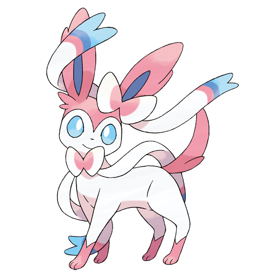

- **種族**: ニンフィア（なつき進化）
- **性別・年齢・学年等**: 女性。20歳（第04巻で「20歳になった」と明記）。ジョウト大学経済学部。入学時は大学1年（B1）で（第04巻）、第05巻では「大2への進級」に言及されている。ブラッキーとエーフィの一人娘
- **立場・職業**: ジョウト大学経済学部の学生。一人暮らしのワンルームでチラーミィと同居し、預かり役の「お姉ちゃん」。サークル『総合ゲーム愛好会（あそび研）』所属
- **外見**: 淡いピンクと白のツヤツヤの毛並み、大きな青い瞳、長いリボン状の触覚。リボンは触手のように自在に動き、抱っこ・防音・物の運搬に使われる。フェアリータイプ特有の、相手の心を鎮めるオーラを放つと描写される。熟れたモモンの実（桃）のような甘くて優しい匂いがし、「黙って微笑んでいれば大学内でも振り返られるほど見た目がやたらと良い」超絶美形と地の文で明記される（第04巻ターン102）
- **性格**: 感情がすぐ顔とリボンに出る「感情の権化」。理屈より熱量でゴリ押すタイプ。入学直後は元気なキャピキャピ系だったが、難関大学の合格後に燃え尽きてダウナー化し、自堕落な「干物生活」（昼食は動画を見ながらBASE BREAD、夜はスーパーの弁当・惣菜）を送っていた。チラーミィが来てからは世話焼きで過保護な「お姉ちゃん」になり、生活リズムと活力を取り戻した。チラーミィにはデレデレで、嫉妬深い一面もある。いざという時は勝負師
- **口調の特徴**: 一人称は「あたし」。甘くくだけた女性口調（「〜だよ〜」「ふふっ」「〜わよ」）。自分のことを「おねーちゃん」と呼ぶ場面が多い。興奮すると猛烈な早口になる。バトル時は勝負師の鋭い口調に切り替わる
- **物語での役割・見せ場**: 主人公格。高校時代は県内屈指の強豪校のポケモンバトル部で先鋒・スイーパー、「伝説の狂犬アタッカー」「狂犬ニンフィア」「破壊の妖精」の異名を持ち、ダブルバトル全国大会レーティング第3位。特攻（C）と素早さ（S）極振りの『CSぶっぱ』＋隠れ特性『フェアリースキン』で『スキンハイパーボイス』を放ち敵チームを更地にしてきた。受験時に引退し約1年のブランク。第02巻では夜道でチラーミィに手を伸ばそうとしたチンピラに闘気を放ち撃退。第05巻では春の学生オープントーナメントにエンニュートとペアで出場し、決勝で1対2の絶体絶命から『のどスプレー』起動＋最大出力『ハイパーボイス』で2体同時撃破の大逆転優勝を果たした。バトル部時代の道具（『おうじゃのしるし』『こだわりメガネ』『きあいのタスキ』『いのちのたま』、『のどスプレー』）を今も所持。第03巻のポケプリッツゲームでのキスが恋愛経験ゼロの彼女のファーストキスだった。思考は脳内議事堂／脳内スパコン『SYLVEON』とその3人格（理性・母性・本能）として描写される。内心では「チラーミィくんが大人になったら、このままあたしが結婚しちゃおうかな…？」とまで考えている（第02巻ターン43、第03巻ターン68）
- **初登場**: 第01巻 ターン1
- **関係のあるキャラ**: エーフィ（母）、ブラッキー（父）、チラーミィ（同居する弟同然の存在。両家公認の同居）、ミミロップ・フライゴン（大学の「いつメン」）、エルフーン・エンニュート・ルカリオ・デンリュウ（あそび研の先輩たち）、エンニュート（第05巻でダブルバトルの相棒）、高校時代の相棒エルフーン（ダブル全国3位のペア、別人）

### チラーミィ

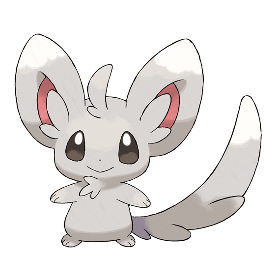

- **種族**: チラーミィ（チンチラポケモン）。石進化ポケモンで、「ひかりのいし」でチラチーノに進化する
- **性別・年齢・学年等**: 男の子。物語開始時は小学1年生。第04巻で小1の修了式を終え、第05巻で小学2年生・8歳（人間換算）と明示。コガネ南小学校2年1組（第06巻）。チラチーノ夫妻の一人息子
- **立場・職業**: 小学生。両親のフィールドワーク不在中、ニンフィアのワンルームに預けられ同居中（第02巻ターン42で両家公認のもと同居継続が正式決定）。ニンフィアの膝の上が「指定席」。第06巻では新学期の係決めで図書係の男子枠を獲得
- **外見**: 小さな体、大きな丸い耳、体と同じくらい大きなふわふわの尻尾、白くてやわらかなほっぺ、くりくりの大きな目。照れると耳の先まで真っ赤になる
- **性格**: 無邪気で素直、正直。甘えん坊で寂しがり屋。賢く空気を読めるため大人の都合を察して「聞き分けのいい子」を演じ、自分を押し殺しがちな面がある（第02巻）。一方で両親への“プチ反抗期”的な態度も見せる。極度のきれい好き・几帳面（種族の習性で、尻尾をほうき・ハタキ代わりにして部屋の埃を払うのが日課。もらったチョコを3×3に整列させる）。朝がめっぽう弱い。超がつく天然で恋愛センサーはポンコツ（「お付き合い」を「出かけるのに付き添うこと」と解釈する）
- **口調の特徴**: 一人称は「ボク」。幼い口調で「だーいすき♡」「〜だもーん」「うん！みるみる！」。背伸びすると理路整然とした大人口調のスピーチもできる（第02巻ターン42）。ニンフィアを「ニンフィアおねーちゃん」「おねーちゃん」と呼ぶ
- **物語での役割・見せ場**: 主人公格。ゲームの天才で、『エースコンバット』フリーミッション・難易度ACE・ミッション18『Lost Kingdom』をF-22Aで、ミサイル1発を囮に敵エース・ミハイのPSMを誘い機関砲で撃破（第01巻）。『大乱闘スマッシュブラザーズ』では「だーいすき♡」と囁く「メロメロ」作戦でニンフィアに大勝利（第01巻）。第02巻では「ボク、どこにもいかない！」という意思表示と理路整然としたスピーチが同居継続決定の決め手になった。隠れ特性『スキルリンク』の持ち主で、尻尾の『スイープビンタ』を5回連続ヒットさせる。小学1年の頃、女の子を守るためガキ大将デルビルに立ち向かい、大泣きしながら繰り出したスイープビンタで一撃KOした「大泣きオーバーキル事件」の当事者（第06巻ターン132の回想）。勉強はオール100点、足はクラス最速レベルで、学校では人気者。バレンタイン（この世界では4月14日）にはチョコ9個（うち本命5個）をもらったが本人に恋愛の自覚はない。第05巻ターン122では決勝戦で最前列から大声援を送り、ニンフィアの大逆転の引き金になった
- **初登場**: 第01巻 ターン4（ターン2のエーフィの電話で先に言及）
- **関係のあるキャラ**: ニンフィア（同居の「お姉ちゃん」。絶対的な安心感と信頼を寄せる）、チラチーノ父・チラチーノ母（両親）、エーフィ・ブラッキー（預け先の両親。孫同然に歓迎される）、ガーディ・リオル（小学校の親友）、エモンガ（クラスメイト。片想いされ告白された相手）、パチリス・ロコン・アマカジ・マリル（本命チョコを渡したクラスメイト女子）、デルビル（小1の頃に対決した相手）、エルフーン・エンニュート（「おねーちゃん」と呼んで懐くあそび研の先輩）、ルカリオ・フライゴン・デンリュウ（「お兄ちゃん」と呼んで慕う）

---

## サークル『あそび研』・大学関係

### ミミロップ

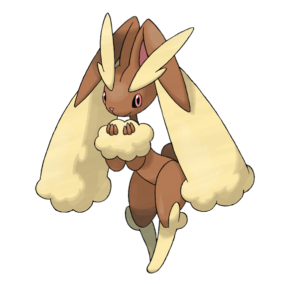

- **種族**: ミミロップ
- **性別・年齢・学年等**: 女性（第06巻で「あそび研女子組」の一員とされる）。ジョウト大学経済学部（第06巻）。学年は（詳細不明）
- **立場・職業**: ニンフィアの学友。ニンフィア、フライゴンと経済学部の「いつメン3人組」の一員。『あそび研』所属。華やかなムードメーカー（第06巻）
- **外見**: （詳細不明）
- **性格**: 明るく、からかい上手。第01巻では木の実キャンディを渡してチラーミィを撫で回し、カフェでニンフィアの普段の「ゾンビ」ぶりや栄養パンを齧る姿を暴露した。第05巻ではニンフィアのエンニュート先輩への嫉妬を図星で突いてからかった
- **口調の特徴**: （詳細不明）。第06巻で「そこ代わんなさい！！」とフライゴンに迫る場面がある
- **物語での役割・見せ場**: 「いつメン」として焼肉やカフェの場面に登場し、ニンフィアの威厳をいじり倒す側。第02巻では夜道の危機でフライゴンと共に暴走しかけたニンフィアを宥めた。第05巻の大会当日は観客席でチラーミィの世話をした
- **初登場**: 第01巻 ターン25
- **関係のあるキャラ**: ニンフィア（学友・いつメン）、フライゴン（いつメン。人気格差で空気扱いする側）、チラーミィ（可愛がる対象）、姉（「ミミロップのお姉ちゃん」が存在し、ニンフィアの友人とされる。第03巻で言及のみ）

### フライゴン

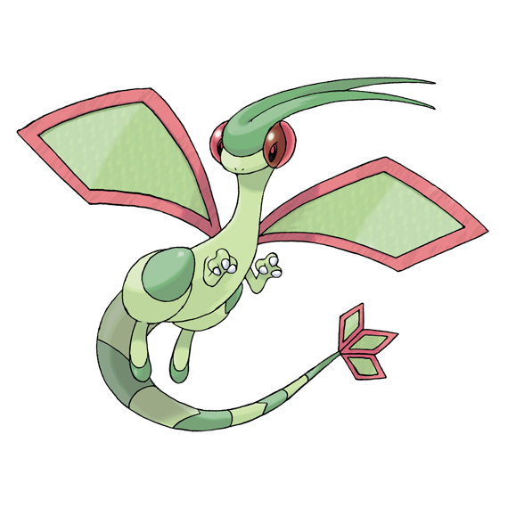

- **種族**: フライゴン（ドラゴンタイプ）
- **性別・年齢・学年等**: 男性。ジョウト大学経済学部2年（第06巻）
- **立場・職業**: ニンフィアの男友達。ニンフィア、ミミロップと経済学部の「いつメン3人組」の一員。『あそび研』所属
- **外見**: 赤い複眼（周囲に「赤いメガネ」と誤解されるが、本人曰く「自前の目（角膜）」）。ヘッドホンを着用（第06巻）。第02巻ではワルビアルに「メガネ蜻蛉」と罵られた
- **性格**: 冷静に対処するタイプ。最大の悩みは影の薄さで、同学科のニンフィアの隣に1年の時からいる友人なのに、学生にも教授にも名前を覚えられていない（第06巻ターン124）
- **口調の特徴**: 冷静な物言い。「道を開けてくれないか。こっちは小さい子も寝てるんだ」（第02巻）。感情が昂ると「メガネじゃなくてこれ自前の目（角膜）です教授ゥゥゥーーッ！！」と叫ぶ（第06巻）
- **物語での役割・見せ場**: 第02巻では夜道でチンピラに冷静に対処し、ニンフィアの暴走をミミロップと共に止めた。第05巻では部室でニンフィアの大会出場を煽った。第06巻「影薄コンビの逆襲」（ターン125〜127）の中心人物の一人で、女子組不在の部室でチラーミィに「フライゴンお兄ちゃん」と呼ばれ、存在を認められたことに号泣した
- **初登場**: 第01巻 ターン29〜30（カフェ合流の場面。正確な初登場ターンはノートに明記なし）
- **関係のあるキャラ**: ニンフィア・ミミロップ（いつメン3人組）、チラーミィ（第06巻で「お兄ちゃん」と呼ばれる関係に進展）、デンリュウ（「影薄コンビ」。魂が同調（シンクロ）する仲）

### デンリュウ

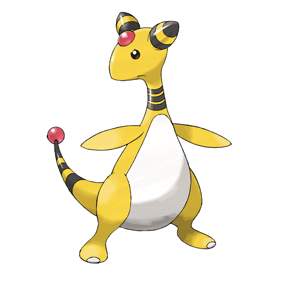

- **種族**: デンリュウ
- **性別・年齢・学年等**: 男性。ジョウト大学工学部・電気電子工学科3年（第06巻）
- **立場・職業**: 『あそび研』のメンバー（先輩）。「影薄いその2」（第06巻）
- **外見**: 黄色いボディ、尻尾の先の赤い玉がチャームポイント。感情で赤い玉が明滅・点滅する（第06巻）
- **性格**: （詳細不明）。能力面では、体内発電の電気をミリ単位で制御でき教授からも頼られる優秀な工学徒。映像撮影・編集の腕も一流（第06巻）
- **口調の特徴**: 一人称「俺」。不遇を訴える長台詞が特徴（第06巻ターン124）
- **物語での役割・見せ場**: 第01巻ではチラーミィの号令でルカリオとハイレベルな将棋対局をした（ルカリオと互角の将棋の名手）。第05巻の大会では工学部から借りたプロ用4Kハイスピードカメラと三脚でニンフィアたちの全試合を完璧に撮影する裏方を担ったが誰にも感謝されず、第06巻で徹夜編集した特製ブルーレイをチラーミィに「天才なの！？」と褒められ、「デンリュウお兄ちゃん」と呼ばれる関係に進展した
- **初登場**: 第01巻 ターン27〜28
- **関係のあるキャラ**: ルカリオ（将棋の好敵手）、フライゴン（「影薄コンビ」）、チラーミィ（第06巻で「お兄ちゃん」と呼ばれる）、ニンフィアほかあそび研メンバー

### ルカリオ

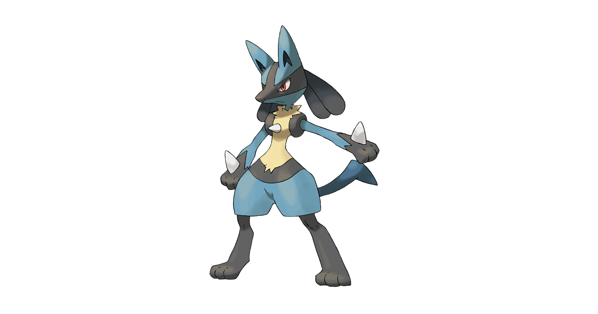

- **種族**: ルカリオ
- **性別・年齢・学年等**: 男性。ジョウト大学理学部・数理解析系3年（第06巻）
- **立場・職業**: 『あそび研』の先輩。ニンフィアの過去を知るバトラーの一人
- **外見**: （詳細不明）
- **性格**: クールで天才肌の数学徒だが、実は誰よりも負けず嫌いで熱い（第06巻）
- **口調の特徴**: 一人称「俺」
- **物語での役割・見せ場**: 第01巻ではチラーミィの号令でデンリュウと将棋対局。第05巻ではニンフィアの特訓でスパーリング相手を買って出た（使用技はインファイト）。大会シングル部門ではスカーフ持ちのサーナイトに初手で奇襲されてベスト16敗退し、チラーミィに麦茶を差し出されて慰められた。第06巻では敗因分析と対サーナイトのダメージ計算に没頭し、秋の学園祭トーナメントでのシングル部門優勝を目標にしている
- **初登場**: 第01巻 ターン27〜28
- **関係のあるキャラ**: チラーミィ（「ルカリオお兄ちゃん」と呼ばれて慕われる）、デンリュウ（互角の将棋の名手同士）、ニンフィア（サークルの後輩。高校時代の伝説を知る側）、サーナイト（大会で敗れた相手）

### エルフーン（あそび研の先輩）

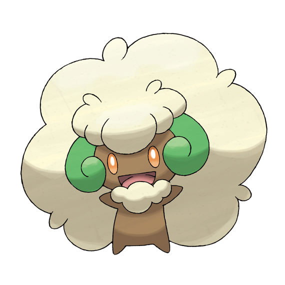

- **種族**: エルフーン
- **性別・年齢・学年等**: 女性（自称「私」や口調からの判断（推測）とノートに明記）。ジョウト大学農学部・応用生命科学科3年（第06巻）
- **立場・職業**: 『あそび研』の先輩。バトルとは生まれてから一切縁がなく、お菓子とボードゲームで「ほんわか」生きてきた
- **外見**: 大きなふわふわの綿毛が特徴で、柔軟剤と天日干しで仕上げる（第06巻）。特注の小さな白衣（背中の穴から綿毛がはみ出る）を着る。特性は『ようりょくそ』と作中で言及される
- **性格**: 穏やかで面倒見が良い、「農学部の良心」。しかし脳内はチラーミィへの愛でいっぱい（地の文曰く「脳内は小2男子でいっぱい」）
- **口調の特徴**: 自称「私」。「むりむりむり！ 絶対むり！！ 私、生まれた時から今まで戦いなんて一切縁がなく、平和にお菓子食べてボードゲームしてぬくぬく生きてきただけの、ただのほんわか綿毛だよ！？」（第05巻ターン114）
- **物語での役割・見せ場**: 第01巻ではデンリュウとルカリオの将棋対局の隣でチラーミィにやさしく解説した。第05巻ではニンフィアから（高校時代の相棒が同種族だった連想で）ダブルバトルの相棒に誘われるが、ロッカーの裏へ逃げ込んで断った。特訓時・大会時は応援席でチラーミィの世話役を担い、「チラーミィくんの専属マネージャーなら命がけで務める」と言うほど可愛がっている。チラーミィが綿毛に埋もれて応援・休憩するのが定位置
- **初登場**: 第01巻 ターン27〜28
- **関係のあるキャラ**: チラーミィ（「エルフーンおねーちゃん」と呼ばれ溺愛）、ニンフィア（サークルの後輩）、高校時代の相棒エルフーン（同種族だが別人）

### エンニュート

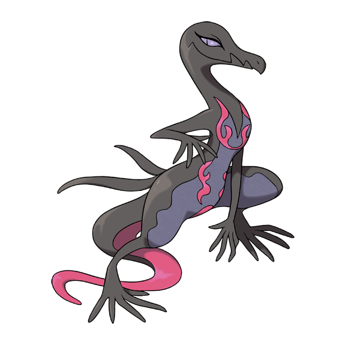

- **種族**: エンニュート
- **性別・年齢・学年等**: 女性。ジョウト大学薬学部・創薬科学科3年（第06巻）
- **立場・職業**: 『あそび研』所属の先輩。「あそび研最強のお姉様」。薬学部でもトップクラスの才女。普段はティラピス（エクササイズ）に通っている。第05巻時点で公式戦の出場履歴はゼロで、実質バトル未経験者だった
- **外見**: 黒と紫のしなやかなボディライン、妖艶な紫色の瞳、長い尻尾。甘くスパイシーな香り（フェロモン）を漂わせる。大学では純白のロング白衣と保護メガネを着用（第06巻）。種族特性として体内で特殊な毒やフェロモンを生成できる
- **性格**: ノリが良く、度胸があり、妖艶で余裕のある「お姉様」。大人の色気と毒舌で周囲を掌握する
- **口調の特徴**: 妖艶な「お姉様」口調。「いいわよ、組んであげる！ 他学部のイキってる男子バトラーどもを、私たち美しいお姉様コンビの火力で片っ端からメロメロのボコボコにしてやりましょ♪」（第05巻ターン115）
- **物語での役割・見せ場**: 第05巻でニンフィアのダブル相棒に選ばれ即快諾。素早さ種族値117の高速アタッカーで、使用技はねこだまし、アンコール、アシッドボム、オーバーヒート。1回戦の3秒粉砕、準決勝での『アンコール』によるトリックルーム解除（トリル返し）、決勝での渾身の『オーバーヒート』など、未経験者ながら完璧な連携で優勝に貢献した。大会後は体育会バトル部の勧誘を色気と投げキッスで全員撃沈させて断った。火力の秘密は「毎日のティラピス」と「チラーミィくんから貰った甘いゼリー」だと答える（第06巻）
- **初登場**: 第05巻 ターン115
- **関係のあるキャラ**: ニンフィア（サークルの後輩でダブルバトルの相棒）、チラーミィ（「エンニュートおねーちゃん」と呼ばれて懐かれる。膝の上でゼリーを食べさせるなど可愛がる）、フシギソウ（薬学部の同じ実験班）

---

## 小学校関係（コガネ南小学校2年1組ほか）

### エモンガ

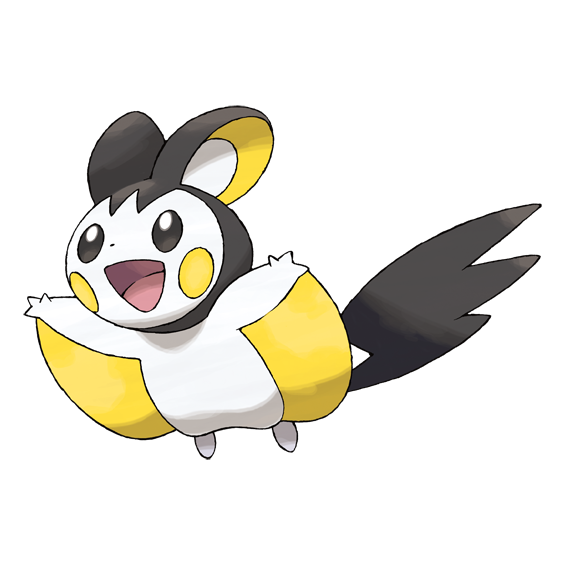

- **種族**: エモンガ（モモンガポケモン）
- **性別・年齢・学年等**: 女子児童。コガネ南小学校2年1組
- **立場・職業**: チラーミィのクラスメイト。第06巻で大きく扱われた準主役級のキャラクター。新学期の係決めで図書係の女子枠をじゃんけんで勝ち取り、チラーミィと図書係コンビを組む
- **外見**: 黄色い翼膜、頬の黄色い電気袋（緊張すると火花がパチパチこぼれる）
- **性格**: 恥ずかしがり屋だが、思い切りのいい一面も。1年生の時からチラーミィを見て想い続けていた
- **口調の特徴**: 「私……チラーミィくんのことが、大好きなの！」「あのね……もしよかったら……私と、と、と……『お付き合い』してくれませんか……！？」（第06巻ターン129の告白）
- **物語での役割・見せ場**: 「エモンガの告白」（第06巻ターン128〜130）の中心人物。中庭でチラーミィに告白するも、「お付き合い＝お散歩の付き添い」と解釈され、手を繋いで花壇を見に行く「初めてのお付き合い（お散歩）」が成立。エモンガ側は「まだ2年生だし、今はこれでいっか」と保留している。内心では「毎日のおやつ作戦」の抜け駆けを画策。図書係じゃんけん決勝でパチリスを破り女子枠を獲得した
- **初登場**: 第06巻 ターン128（バレンタイン編など前巻で名前が挙がっていた可能性はあるとノートに注記）
- **関係のあるキャラ**: チラーミィ（1年生の時からの片想いの相手。図書係コンビ）、パチリス・ロコン・アマカジ・マリル（本命チョコを渡した「ガチ勢5匹」の仲間でありライバル）

### ガーディ

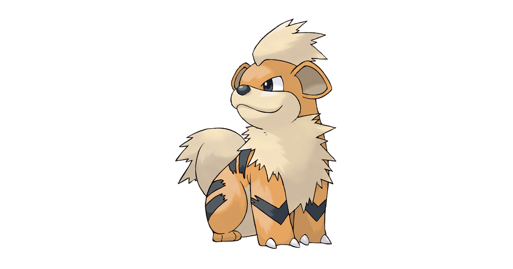

- **種族**: ガーディ（こいぬポケモン）。石進化対象で進化先はウインディ
- **性別・年齢・学年等**: 男子児童（第06巻）。コガネ南小学校2年1組
- **立場・職業**: チラーミィの小学校のクラスメイトで一番の仲良し（第03巻）。2年生でもクラス持ち上がりで同じクラス（第04巻）。第06巻では体育係に決定
- **外見**: （詳細不明）
- **性格**: やんちゃで元気いっぱい。尻尾をブンブン振る（第06巻）。素直な性格で、ニンフィアを目の当たりにした際は耳の先まで真っ赤になり、緊張で語尾を噛んだ（第04巻）
- **口調の特徴**: 「チラーミィ、また月曜日に学校でなー！」と明るく元気な口調（第05巻）。緊張時は「お、おじゃましましゅ……」と小声でもじもじする（第04巻ターン102）
- **物語での役割・見せ場**: 第03巻では言及のみ（休み時間にチラーミィと鬼ごっこをする一番の仲良し。両親から進化の石は「もっと落ち着いたら渡してあげる」と言われている例として挙げられた）。第04巻ターン101の学校場面で初めて画面に登場し、ターン102でリオルと共にニンフィアのマンションを初訪問。ニンフィアの美貌に「「……っ、ドキンっ！！」」とリオルと同時心拍し、おしりを叩いてジュースを注文するチラーミィを「伝説の勇者」を見るような眼差しで見つめた。スマブラではリザードンを使用し、チラーミィに圧倒される。ニンフィアの『特製はちみつバターマドレーヌ』を「ケーキ屋さんで売れるよ！」と絶賛した（第04巻ターン102）。なお訪問前には『世界のアソビ大全』での対戦を希望していた（第04巻ターン101）。リオルと共に、学校でのチラーミィの評価（勉強は全部100点、鬼ごっこは誰より速い）を証言した（第04巻ターン102）。第05巻ターン103でもリオルと共にチラーミィの家へ遊びに来て、ニンフィアのマドレーヌを絶賛した。第06巻では休み時間のドッジボール対決にチラーミィを誘う
- **初登場**: 第04巻 ターン101（言及はそれ以前。第03巻 ターン68から）
- **関係のあるキャラ**: チラーミィ（一番の仲良し）、リオル（共に親友で、共に体育係）、ニンフィア（憧れの「綺麗なジョウト大のお姉さん」）、両親（親子。種族・名前は詳細不明）

### リオル

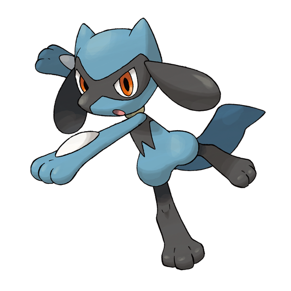

- **種族**: リオル（はどうポケモン）
- **性別・年齢・学年等**: 男子児童（第06巻）。コガネ南小学校2年1組
- **立場・職業**: チラーミィの小学校のクラスメイト。2年生でもクラス持ち上がりで同じクラス（第04巻）。第06巻ではガーディと共に体育係
- **外見**: 青い腕を組む姿が描かれる（第06巻）
- **性格**: 少しませたタイプ（青い腕を組んでニヤリと笑う）。好奇心旺盛で質問上手（第04巻）
- **口調の特徴**: 好奇心旺盛な質問口調。「ねえ、チラーミィって学校だと勉強も全部100点だし、鬼ごっこも誰より速くてすごいんですけど……お家だとどんな感じなんですか？」（第04巻ターン102）
- **物語での役割・見せ場**: 冬休みの時点で「休み時間に鬼ごっこをする仲良し」として言及されていた（第04巻ターン100でニンフィアが回想）。第04巻ターン101の学校場面で初めて画面に登場し、ターン102でガーディと共にニンフィアのマンションを初訪問。ニンフィアを前に視線を泳がせて緊張したが、りんごジュースとゲームでほぐれた。ガーディと共に学校でのチラーミィの評価（勉強は全部100点、鬼ごっこは誰より速い）を証言し、巻末では「お家でのチラーミィはどんな感じなんですか？」という質問でニンフィアの暴露開始の引き金を引いた（第04巻ターン102）。第05巻ターン103でもガーディと共に来訪し、チラーミィを「お家でもカッコいい」と褒めた。第06巻ではドッジボール対決にチラーミィを誘う
- **初登場**: 第04巻 ターン101（言及はそれ以前）
- **関係のあるキャラ**: チラーミィ（親友）、ガーディ（共に親友で、共に体育係）、ニンフィア（憧れの「綺麗なジョウト大のお姉さん」）

### パチリス

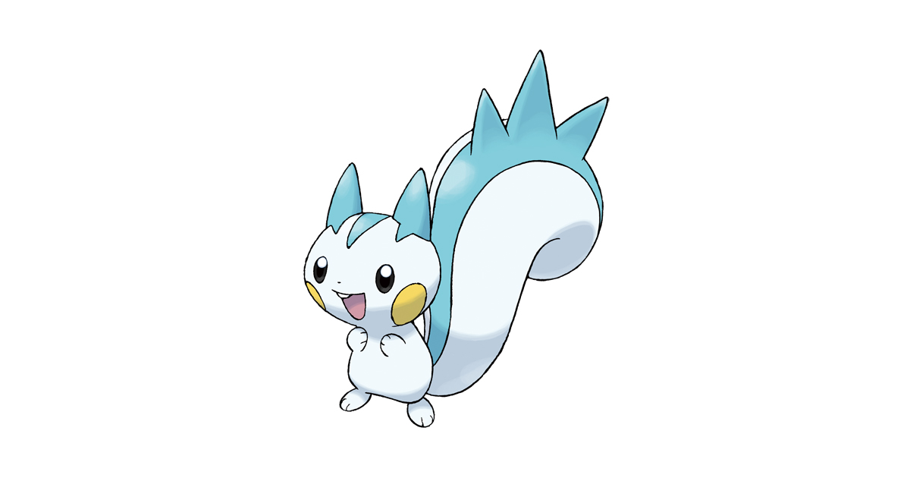

- **種族**: パチリス
- **性別・年齢・学年等**: 女子児童。コガネ南小学校2年1組
- **立場・職業**: チラーミィのクラスメイト。バレンタインに本命チョコを渡した「ガチ勢5匹」の1匹
- **外見**: （詳細不明）
- **性格**: （詳細不明）
- **口調の特徴**: （詳細不明）
- **物語での役割・見せ場**: 第06巻で告白事件の報告会に参加し休戦協定を結ぶが、内心では「席替えでチラーミィくんの隣を引き当てる」抜け駆けを画策。図書係じゃんけんでは決勝まで進むがエモンガに敗北し、敗れた4匹と共に美化係や黒板係に収まった
- **初登場**: 第06巻 ターン131（本格的に登場。本命チョコを渡した子としての言及は第05巻から）
- **関係のあるキャラ**: チラーミィ（本命チョコを渡した相手）、エモンガ・ロコン・アマカジ・マリル（「ガチ勢5匹」の仲間でありライバル）

### ロコン

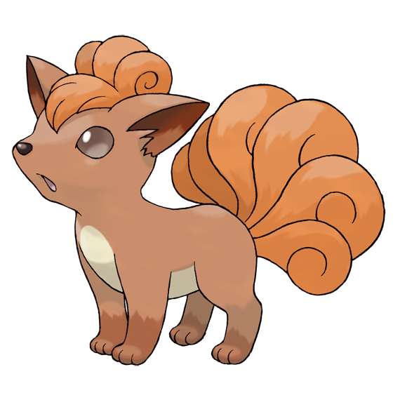

- **種族**: ロコン
- **性別・年齢・学年等**: 女子児童。コガネ南小学校2年1組
- **立場・職業**: チラーミィのクラスメイト。「ガチ勢5匹」の1匹
- **外見**: （詳細不明）
- **性格**: （詳細不明）
- **口調の特徴**: （詳細不明）
- **物語での役割・見せ場**: 第06巻で休戦協定を結ぶが、内心では次の理科の観察グループでチラーミィと同じ班になるよう既に先生にアピール済み。図書係じゃんけん第1ラウンドで脱落した
- **初登場**: 第06巻 ターン131（本格的に登場）
- **関係のあるキャラ**: チラーミィ（本命チョコを渡した相手）、エモンガ・パチリス・アマカジ・マリル（「ガチ勢5匹」の仲間でありライバル）

### アマカジ

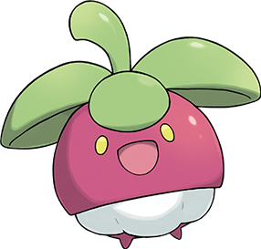

- **種族**: アマカジ
- **性別・年齢・学年等**: 女子児童。コガネ南小学校2年1組
- **立場・職業**: チラーミィのクラスメイト。「ガチ勢5匹」の1匹
- **外見**: （詳細不明）
- **性格**: （詳細不明）
- **口調の特徴**: （詳細不明）
- **物語での役割・見せ場**: 第06巻で休戦協定を結ぶが、マリルと共に「放課後いっしょに帰る約束を取り付ける」抜け駆けを計画。図書係じゃんけんではあいこラウンドで脱落した
- **初登場**: 第06巻 ターン131（本格的に登場）
- **関係のあるキャラ**: チラーミィ（本命チョコを渡した相手）、マリル（抜け駆けを共に計画）、エモンガ・パチリス・ロコン（「ガチ勢5匹」の仲間でありライバル）

### マリル

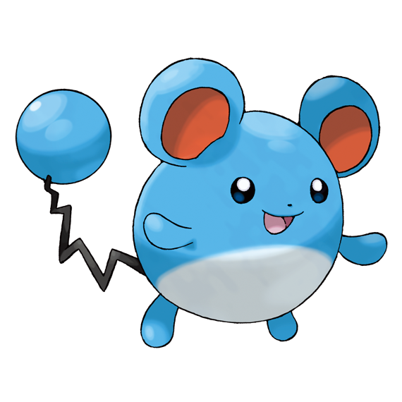

- **種族**: マリル
- **性別・年齢・学年等**: 女子児童。コガネ南小学校2年1組
- **立場・職業**: チラーミィのクラスメイト。「ガチ勢5匹」の1匹
- **外見**: （詳細不明）
- **性格**: （詳細不明）
- **口調の特徴**: （詳細不明）
- **物語での役割・見せ場**: 第06巻で休戦協定を結ぶが、アマカジと共に「放課後いっしょに帰る約束を取り付ける」抜け駆けを計画。図書係じゃんけん第1ラウンドで脱落した
- **初登場**: 第06巻 ターン131（本格的に登場）
- **関係のあるキャラ**: チラーミィ（本命チョコを渡した相手）、アマカジ（抜け駆けを共に計画）、エモンガ・パチリス・ロコン（「ガチ勢5匹」の仲間でありライバル）

### デルビル

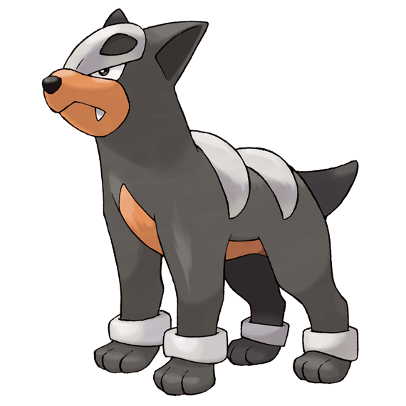

- **種族**: デルビル
- **性別・年齢・学年等**: （詳細不明）。小学1年生の頃の回想に登場し、チラーミィより体の大きな存在
- **立場・職業**: よそのクラスの体の大きなガキ大将（いじめっ子）
- **外見**: 体が大きい（他は詳細不明）
- **性格**: ガキ大将（いじめっ子）。女の子の花冠を取り上げて泣かせた
- **口調の特徴**: （詳細不明）
- **物語での役割・見せ場**: 第06巻ターン132の過去回想に登場。小学1年の頃、女の子を守るため立ち向かってきたチラーミィの大泣きスイープビンタ（スキルリンクで確定5回ヒット）で一撃KOされ、砂場まで吹っ飛んだ。この事件以来、チラーミィは男子たちに畏敬されるようになった
- **初登場**: 第06巻 ターン132（回想内）
- **関係のあるキャラ**: チラーミィ（対決して倒された相手）

### モココ先生

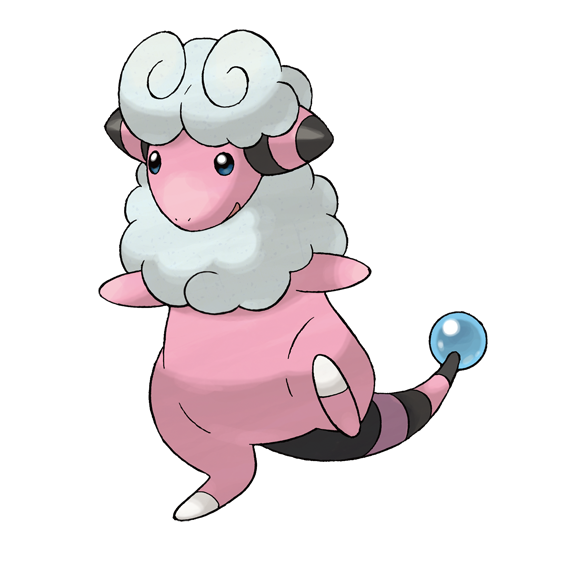

- **種族**: モココ
- **性別・年齢・学年等**: （詳細不明）
- **立場・職業**: コガネ南小学校2年1組の担任
- **外見**: （詳細不明）
- **性格**: 優しくおっとり。図書係に5人も立候補してタジタジになる（第06巻）
- **口調の特徴**: （詳細不明）
- **物語での役割・見せ場**: 第06巻ターン133で係決めを進行し、図書係の女子枠に立候補した5匹に教室の後ろでじゃんけん対決を行うよう指示した
- **初登場**: 第06巻 ターン128
- **関係のあるキャラ**: チラーミィ、エモンガ、ガーディ、リオル、パチリス、ロコン、アマカジ、マリルほか2年1組の児童（担任と児童）

### イエッサン先生

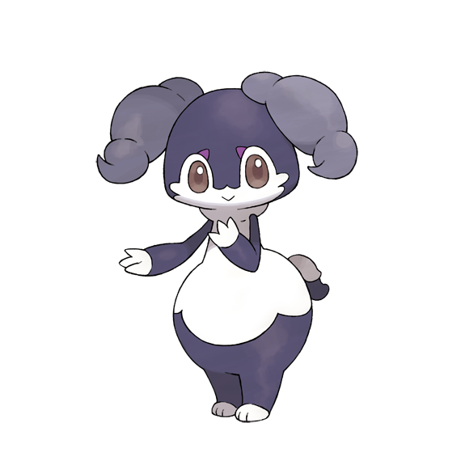

- **種族**: イエッサン
- **性別・年齢・学年等**: （詳細不明）
- **立場・職業**: コガネ南小学校の図書室の司書
- **外見**: （詳細不明）
- **性格**: （詳細不明）。チラーミィの「いらっしゃいませ〜」を優しく訂正し続ける様子が描かれる
- **口調の特徴**: 「ふふっ、こらこらチラーミィくん。ここはお店屋さんじゃなくて図書室なんだから、『いらっしゃいませ』は違うでしょ？ 『こんにちは』ですよ」（第06巻ターン135）
- **物語での役割・見せ場**: 第06巻ターン135の図書室当番で、チラーミィが来室者ごとに「いらっしゃいませ〜」と言うたびに優しく訂正する
- **初登場**: 第06巻 ターン135
- **関係のあるキャラ**: チラーミィ（図書係の児童として指導）、エモンガ（図書係の児童）

---

## 家族

### エーフィ

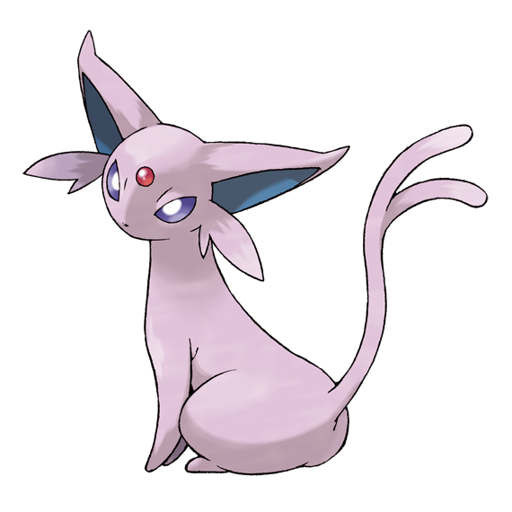

- **種族**: エーフィ（なつき進化）。エスパータイプで読心ができる
- **性別・年齢・学年等**: 女性。ニンフィアの母。年齢は（詳細不明）
- **立場・職業**: 元メガバンク勤務で、ブラッキーとは職場の同僚同士の社内結婚。今年の春に夫婦で早期退職しFIRE（経済的自立と早期リタイア）を達成（第03巻）。実家で夫と暮らし、里帰り時の料理担当
- **外見**: 薄紫色の毛並み（第03巻）
- **性格**: 落ち着いた策士タイプで、すべてを見通すような物言いをし、娘の弱点を千里眼のように突いてくる。飄々として茶目っ気があり、娘をからかうのが好き。見た目は厳格・冷静だが実態はお祭り騒ぎ好きで甘い。チラーミィの来訪が決まると「絶対に連れてきなさい！」と熱量高く大歓迎する
- **口調の特徴**: 落ち着いたトーンに優雅な女性口調（「〜わ」「〜なのよ」「おほほほ♪」）。「一番大事なのはチラーミィくん本人の気持ち」と念を押す
- **物語での役割・見せ場**: 物語の仕掛け人。第01巻ターン2の電話でチラーミィの預かりを一方的に依頼。第03巻では、チラーミィをニンフィアに預ける「賭け」を仕掛けた張本人だったことが明かされ（娘のプライドを刺激する言い方で半ば強引に送り込んだ）、ニンフィアの燃え尽き時代の黒歴史をチラーミィに暴露した。『世界のアソビ大全51』のテキサスホールデムでは読心能力をフル活用して無双する一方、モンハンではコントローラーをガン見する初心者で2乙した。新婚旅行先のビーチで、ブラッキーと同日に昼になつき進化した（第03巻ターン74）
- **初登場**: 第01巻 ターン2（電話。対面は第02巻ターン40）
- **関係のあるキャラ**: ブラッキー（夫）、ニンフィア（娘）、チラーミィ（孫同然に歓迎）、チラチーノ夫妻（親戚同士。「息子を預かってほしい」と相談を受けた）

### ブラッキー

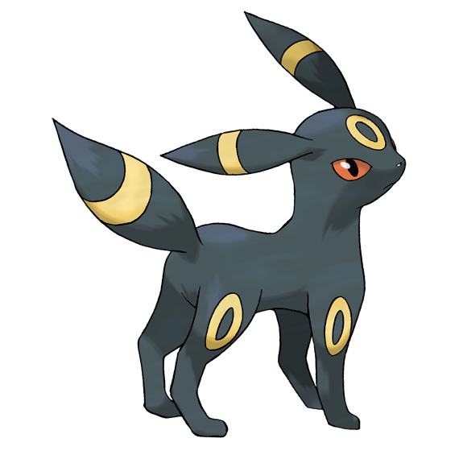

- **種族**: ブラッキー（なつき進化）
- **性別・年齢・学年等**: 男性。ニンフィアの父。年齢は（詳細不明）
- **立場・職業**: 元メガバンク（ジパング経済の中枢を担う超大手銀行）のエリートバンカー。エーフィとは社内結婚。今年の春に夫婦で早期退職しFIRE達成。現在は自宅の4枚マルチモニターで資産運用・トレードを行うのが「お仕事みたいなもの」（第03巻）
- **外見**: 黒い毛並み
- **性格**: 静かな威厳と優しさを纏う寡黙タイプ。ただし可愛い子には甘く、チラーミィ来訪の報せでは家の中を駆け回り、羽毛布団を干しケーキ屋を予約するほど浮かれる。ゲーム好きでロマン派。娘とチラーミィには弱い
- **口調の特徴**: 一人称「俺」。穏やかで落ち着いた男性口調。「今夜はリクエスト通りすき焼きを用意してある」（第02巻ターン62）
- **物語での役割・見せ場**: 第03巻でFIRE判明の語り手となり、機関投資家レベルのトレード画面や、リビングの120インチ・240Hz・8K・有機EL巨大モニターを見せる。モンハンはガンランス愛用のロマン砲（竜撃砲・フルバースト）好きで味方を爆風に巻き込みがち。「実はチラーミィくんに救われたのは、うちの娘の方だったんだな」と両親の賭けを総括した（ターン69）。チラーミィがニンフィアの頬へキスした場面では箸を取り落として固まり、翌朝までスマホで検索し続けて自分の価値観が古いのか悩んだ（ターン72・73）。新婚旅行先でエーフィと同日に夜になつき進化した（本人の説明は「銀行の同期として苦楽を共にするうちに信頼関係が深まった」だが、実情はニンフィアに暴露された）
- **初登場**: 第02巻 ターン40（対面）
- **関係のあるキャラ**: エーフィ（妻）、ニンフィア（一人娘）、チラーミィ（孫同然に歓迎。迎えの車＝ネイビーのセダンの運転も務めた）、チラチーノ夫妻（親戚同士）

### チラチーノ（父）

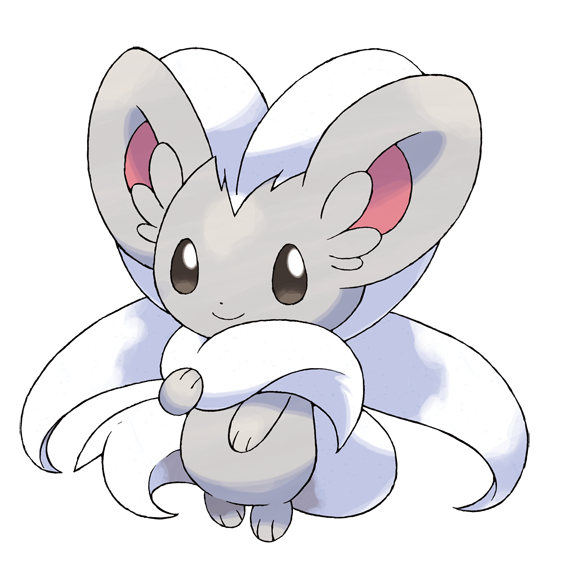

- **種族**: チラチーノ
- **性別・年齢・学年等**: 男性。チラーミィの父親。年齢は（詳細不明）
- **立場・職業**: フィールドワーク系学者・生物学者。1636年創立のイッシュ大学（イッシュ大陸最古の私立高等教育機関、世界ランキング1位級の超名門）の同じ研究室で妻と出会い結婚（第03巻）。勤務先は『ヒウン国際生物科学研究所』（第04巻）。世界中の古代遺跡や未開の自然環境を調査し、調査団のリーダーに抜擢されるほどの実績。古代のコケと『保水ゼリー』を応用した乾燥地向け新農業のビッグプロジェクトを進行中（第04巻）
- **外見**: 眼鏡をかけている（第04巻）。スカーフのような毛並み（夫妻共通の描写）
- **性格**: 朗らかで風のように掴みどころのない明るさ。研究のことになると周りが見えなくなる（ブラッキーの評）。息子想いで豪快におもてなしし、よく大笑いする。実はマジック好き
- **口調の特徴**: 朗らか。第02巻ターン41でニンフィアに「大学生で勉強も大切だろう。正直な気持ちを聞かせてほしい。これ以上預かるのは負担で迷惑か」と問うた
- **物語での役割・見せ場**: 第02巻ターン40で初登場し、両家の食事会で職業や遠征の経緯が判明。息子本人の意思を尊重して同居継続に大賛成した。第04巻ではイッシュ旅行の招待者・スポンサーの一人として、ブロードウェイのマジックショーのプラチナチケットを取った張本人とされ、息子に「ほんとはパパが見たいだけでしょ」とツッコまれた。先月からマスカーニャのトリックボムのタネを科学的に解明したがっていた
- **初登場**: 第02巻 ターン40
- **関係のあるキャラ**: チラチーノ（母）（妻）、チラーミィ（一人息子）、ニンフィア（息子の預け先。「もう僕たちの本当の娘みたいなもの」と呼ぶ）、ブラッキー・エーフィ（親戚同士）

### チラチーノ（母）

- **種族**: チラチーノ
- **性別・年齢・学年等**: 女性。チラーミィの母親。年齢は（詳細不明）
- **立場・職業**: 夫と同じくフィールドワーク系学者・生物学者。イッシュ大学の同じ研究室で夫と出会い結婚。勤務先は『ヒウン国際生物科学研究所』で、夫とビッグプロジェクトを進行中。普段は砂漠のテント生活か研究所に24時間缶詰の生活で、給料も特許料も口座に貯まる一方と語る（第04巻）
- **外見**: 白いスカーフのような美しい毛並み
- **性格**: 朗らかで明るい。息子の性格（賢すぎて自分を押し殺しがち）を深く理解している。おもてなしが豪快で惜しみない。夫のマジック好きを暴露するお茶目さもある
- **口調の特徴**: LINEで「春休みにこちらの研究所へ遊びに来ないか。往復の飛行機代もホテル代もニンフィアちゃんの分まで出す」（第04巻ターン83）
- **物語での役割・見せ場**: 第02巻ターン40で初登場し、両家の食事会に出席。再会時にはチラーミィが隣の席へ移り、首元のスカーフ状の毛並みに顔をうずめて「むぎゅっ」と甘えた。第04巻ではイッシュ旅行の招待者・スポンサーで、研究所プロジェクトをアニメーション図解で噛み砕いて説明し、帰路のファーストクラスへのアップグレードまで手配した
- **初登場**: 第02巻 ターン40
- **関係のあるキャラ**: チラチーノ（父）（夫）、チラーミィ（一人息子）、ニンフィア（息子の預け先。「もう僕たちの本当の娘みたいなもの」と呼ぶ）、ブラッキー・エーフィ（親戚同士）

---

## その他

### 高校時代の相棒（エルフーン）

- **種族**: エルフーン（個人名の記載なし）
- **性別・年齢・学年等**: （詳細不明）
- **立場・職業**: ニンフィアの高校時代のダブルバトルの相棒
- **外見**: （詳細不明）
- **性格**: （詳細不明）
- **口調の特徴**: （詳細不明）
- **物語での役割・見せ場**: 高校時代、ニンフィアと組んでダブル全国3位になった（第05巻ターン114で言及のみ、本人の登場はない）。ニンフィアが種族の連想から『あそび研』のエルフーン先輩を相棒に誘うきっかけになった。なお、『あそび研』のエルフーン先輩とは同種族の別人で、血縁関係があるという記述もない
- **初登場**: （登場なし。第05巻 ターン114で言及のみ）
- **関係のあるキャラ**: ニンフィア（高校時代の相棒）

### ズルズキン

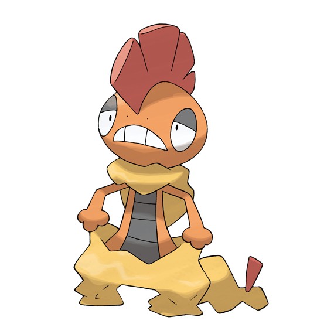

- **種族**: ズルズキン
- **性別・年齢・学年等**: （詳細不明）
- **立場・職業**: 夜道で絡んでくるガラの悪い二人組の一人（チンピラポケモン）
- **外見**: （詳細不明）
- **性格**: ガラが悪く、下品に絡む
- **口調の特徴**: （詳細不明）
- **物語での役割・見せ場**: 第02巻ターン49でニンフィアに下品に絡み、チラーミィの近くへ手を伸ばそうとしてニンフィアの逆鱗に触れる。ターン50でニンフィアの闘気を感じてワルビアルとともに謝罪しながら逃走した（実際のバトルには至っていない）。なお、手を伸ばした主体がズルズキンかワルビアルかはノート内でも記述が揺れている
- **初登場**: 第02巻 ターン49
- **関係のあるキャラ**: ワルビアル（二人組の相方）、ニンフィア（敵対・一時的）

### ワルビアル

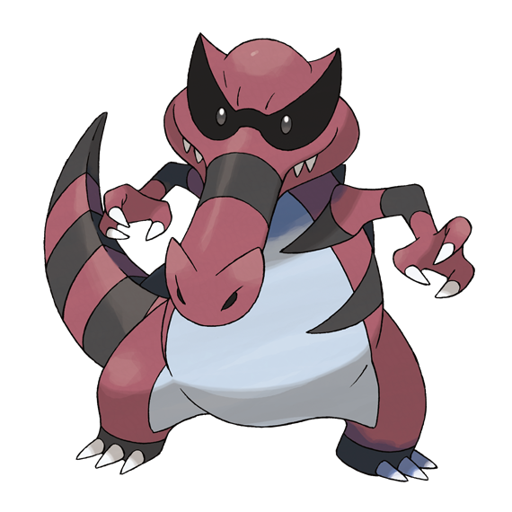

- **種族**: ワルビアル（あくタイプ入りと第02巻でミミロップが発言）
- **性別・年齢・学年等**: （詳細不明）
- **立場・職業**: ズルズキンと組むチンピラポケモンの一人
- **外見**: （詳細不明）
- **性格**: 挑発的
- **口調の特徴**: 挑発的。フライゴンを「メガネ蜻蛉」と罵る（第02巻ターン49）
- **物語での役割・見せ場**: 第02巻ターン49でフライゴンを罵るなど挑発するが、ターン50でニンフィアのプレッシャーに恐怖し、ズルズキンとともに謝罪しながら逃走した
- **初登場**: 第02巻 ターン49
- **関係のあるキャラ**: ズルズキン（二人組の相方）、ニンフィア（敵対・一時的）、フライゴン（罵って挑発した相手）

### レントラー

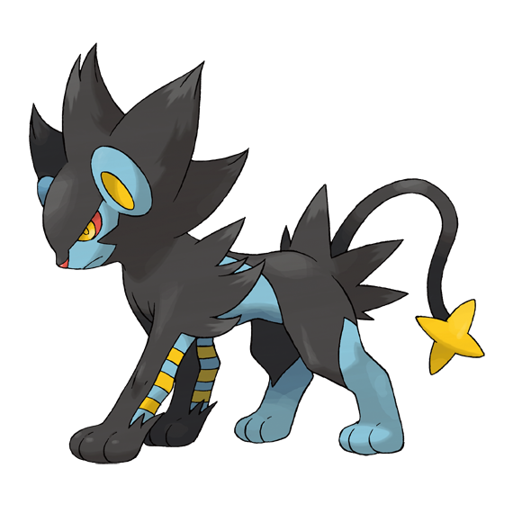

- **種族**: レントラー
- **性別・年齢・学年等**: （詳細不明）
- **立場・職業**: 空港の保安検査場の検査官
- **外見**: （詳細不明）
- **性格**: （詳細不明）
- **口調の特徴**: 「上空で装着してハイパーボイス等をぶっ放さないよう」厳重注意したことが記される（第04巻）
- **物語での役割・見せ場**: 第04巻ターン83で、バトル道具（『こだわりメガネ』『いのちのたま』『きあいのタスキ』）を機内持ち込みしようとしたニンフィアを止めた。危険物には該当しないため通過は許可したが厳重注意した
- **初登場**: 第04巻 ターン83
- **関係のあるキャラ**: ニンフィア（保安検査で止めて厳重注意した相手）

### ハクリュー

- **種族**: ハクリュー
- **性別・年齢・学年等**: （詳細不明）
- **立場・職業**: ヒウン国際空港行き第104便の客室乗務員（第04巻）
- **外見**: （詳細不明）
- **性格**: （詳細不明）
- **口調の特徴**: （詳細不明）
- **物語での役割・見せ場**: ビジネスクラス便の客室乗務員として登場。個別の接客描写は（詳細不明）
- **初登場**: 第04巻 ターン84〜85
- **関係のあるキャラ**: ニンフィア、チラーミィ（搭乗した便の乗客）

### ムーランド

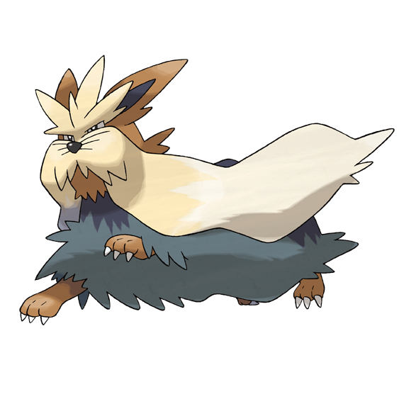

- **種族**: ムーランド
- **性別・年齢・学年等**: （詳細不明）
- **立場・職業**: ハイヤーの運転手。黒塗りの高級セダンを運転する。チラチーノ夫妻の手配による
- **外見**: （詳細不明）
- **性格**: （詳細不明）
- **口調の特徴**: ホテルについて、創業百年以上のヒウンシティの象徴的ホテルであり、今夜の部屋は映画で主人公の少年が泊まったのと同じグレードのスイートルームだと解説した（第04巻）
- **物語での役割・見せ場**: 第04巻ターン84〜85でヒウン国際空港の正面ロータリーに『Welcome! ニンフィア様・チラーミィ様』のプレートを掲げて待ち、スカイアローブリッジを渡ってヒウンシティへ送った。観光後にもホテルへ送り、ホテルの解説をした
- **初登場**: 第04巻 ターン84〜85
- **関係のあるキャラ**: ニンフィア、チラーミィ（出迎え・送迎の相手）、チラチーノ夫妻（手配者）

### ランクルス

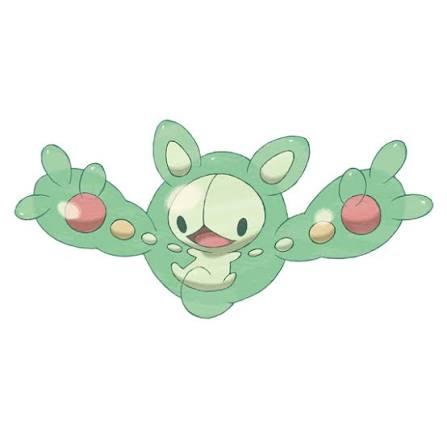

- **種族**: ランクルス
- **性別・年齢・学年等**: （詳細不明）
- **立場・職業**: 『ヒウン国際生物科学研究所』の研究員
- **外見**: （詳細不明）
- **性格**: （詳細不明）
- **口調の特徴**: （詳細不明）
- **物語での役割・見せ場**: 研究所を訪れたニンフィアとチラーミィを歓迎した研究員たちの一人として名前のみ挙がる（第04巻）
- **初登場**: 第04巻 ターン86〜87
- **関係のあるキャラ**: ニンフィア、チラーミィ（研究所で歓迎した相手）、チラチーノ夫妻（同じ研究所の研究員）

### ウォーグル

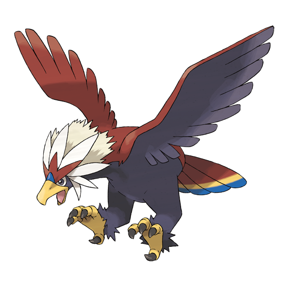

- **種族**: ウォーグル
- **性別・年齢・学年等**: （詳細不明）
- **立場・職業**: 『ヒウン国際生物科学研究所』の研究員
- **外見**: （詳細不明）
- **性格**: （詳細不明）
- **口調の特徴**: （詳細不明）
- **物語での役割・見せ場**: 研究所を訪れたニンフィアとチラーミィを歓迎した研究員たちの一人として名前のみ挙がる（第04巻）
- **初登場**: 第04巻 ターン86〜87
- **関係のあるキャラ**: ニンフィア、チラーミィ（研究所で歓迎した相手）、チラチーノ夫妻（同じ研究所の研究員）

### シンボラー

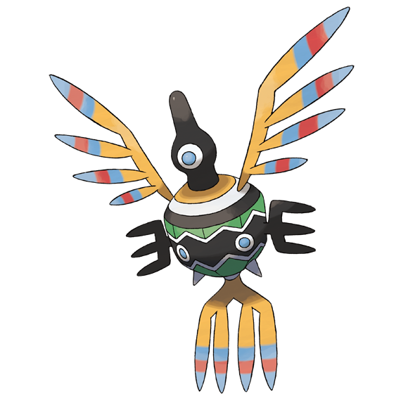

- **種族**: シンボラー
- **性別・年齢・学年等**: （詳細不明）
- **立場・職業**: 『ヒウン国際生物科学研究所』の研究員
- **外見**: （詳細不明）
- **性格**: （詳細不明）
- **口調の特徴**: （詳細不明）
- **物語での役割・見せ場**: 研究所を訪れたニンフィアとチラーミィを歓迎した研究員たちの一人として名前のみ挙がる（第04巻）
- **初登場**: 第04巻 ターン86〜87
- **関係のあるキャラ**: ニンフィア、チラーミィ（研究所で歓迎した相手）、チラチーノ夫妻（同じ研究所の研究員）

### レパルダス

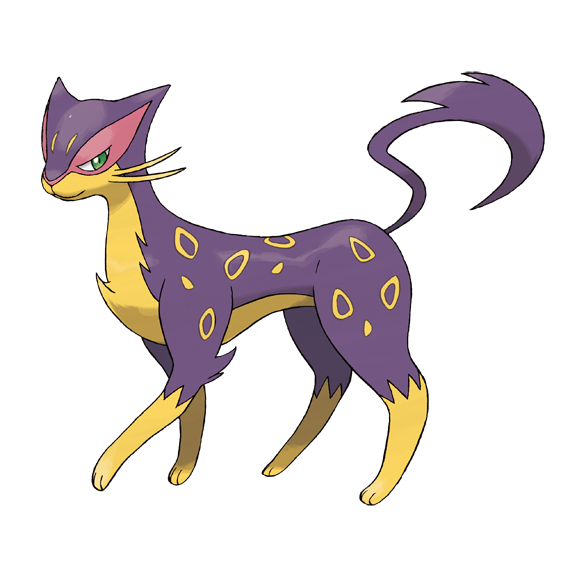

- **種族**: レパルダス
- **性別・年齢・学年等**: （詳細不明）
- **立場・職業**: ヒウンシティの大ホテル（フランス・ルネサンス様式、創業百年以上）のベルボーイ
- **外見**: （詳細不明）
- **性格**: （詳細不明）
- **口調の特徴**: （詳細不明）
- **物語での役割・見せ場**: 第04巻ターン88〜89でニンフィアとチラーミィを『ロイヤル・スイートルーム』へ案内した
- **初登場**: 第04巻 ターン88〜89
- **関係のあるキャラ**: ニンフィア、チラーミィ（宿泊する部屋へ案内した相手）

### マスカーニャ

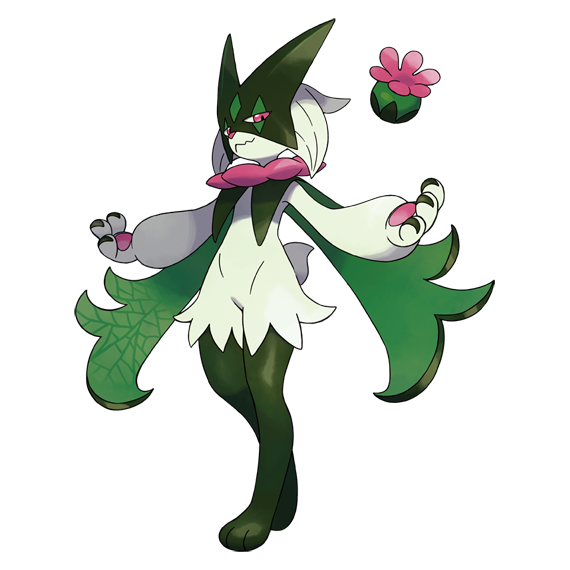

- **種族**: マスカーニャ
- **性別・年齢・学年等**: （詳細不明）
- **立場・職業**: 世界的マジシャン。ブロードウェイの劇場（1924年オープン）で特別ショーを行った（第04巻）
- **外見**: （詳細不明）
- **性格**: （詳細不明）
- **口調の特徴**: （詳細不明）
- **物語での役割・見せ場**: 第04巻ターン91〜92で、花びらの嵐、光の蝶、鉄の檻の大爆発とシャンデリア上への瞬間移動など、大仕掛けイリュージョンとクロースアップマジックの連続で観客全員を圧倒し、フィナーレは総立ちのスタンディングオベーションだった
- **初登場**: 第04巻 ターン91〜92
- **関係のあるキャラ**: チラチーノ（父）（ショーの観客。トリックボムのタネを科学的に解明したがっていた）、チラーミィ、ニンフィア、チラチーノ（母）（ショーの観客）

### フーディン教授

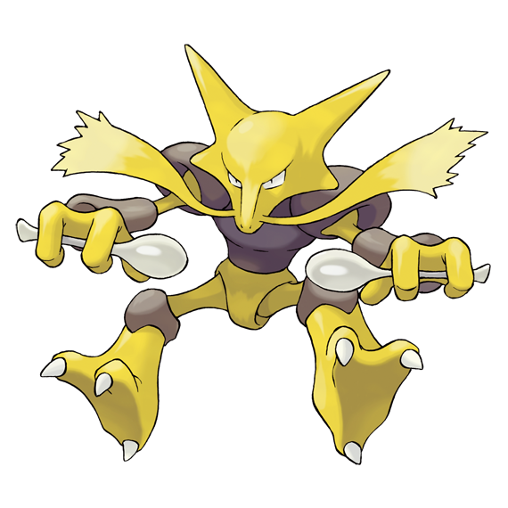

- **種族**: フーディン
- **性別・年齢・学年等**: （詳細不明）。「教授」の肩書きのみ記述あり
- **立場・職業**: TVニュース番組『ひるポケ！ワイド』のスタジオコメンテーター
- **外見**: （詳細不明）
- **性格**: （詳細不明）
- **口調の特徴**: （詳細不明）
- **物語での役割・見せ場**: メディア内登場（第03巻ターン76）。進化の石の公的支援について「進化することは贅沢ではなく、すべてのポケモンが生まれながらに持つ基本的権利（進化権）である」とTVで語った
- **初登場**: 第03巻 ターン76
- **関係のあるキャラ**: （詳細不明）

### カイリキー

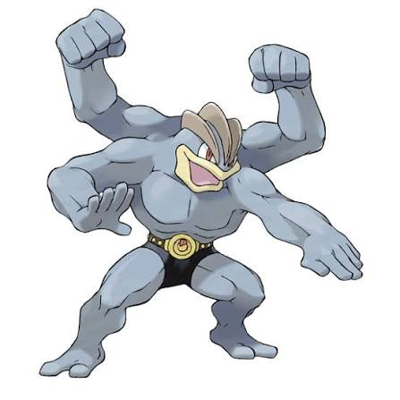

- **種族**: カイリキー
- **性別・年齢・学年等**: （詳細不明）。運動部男子コンビの一人とされる
- **立場・職業**: 運動部男子コンビとして春の学生オープントーナメント大会に出場
- **外見**: （詳細不明）
- **性格**: ゴロンダと共にニンフィアとエンニュートを見て「かわいいねえ、えっど！」と鼻の下を伸ばした（第05巻ターン120）
- **口調の特徴**: （詳細不明）
- **物語での役割・見せ場**: ゴロンダとのペアで大会1回戦の相手。エンニュートの『ねこだまし』とニンフィアの『マジカルシャイン』で試合時間わずか3秒で粉砕された。なお第05巻ターン123で同種族名の体育会バトル部部員（ゴロンダ、バシャーモ、カイリキー）がエンニュート勧誘に登場するが、1回戦の個体と同一かどうかは（詳細不明）
- **初登場**: 第05巻 ターン120
- **関係のあるキャラ**: ゴロンダ（1回戦のペア相手）、ニンフィア、エンニュート（1回戦の対戦相手）

### ゴロンダ

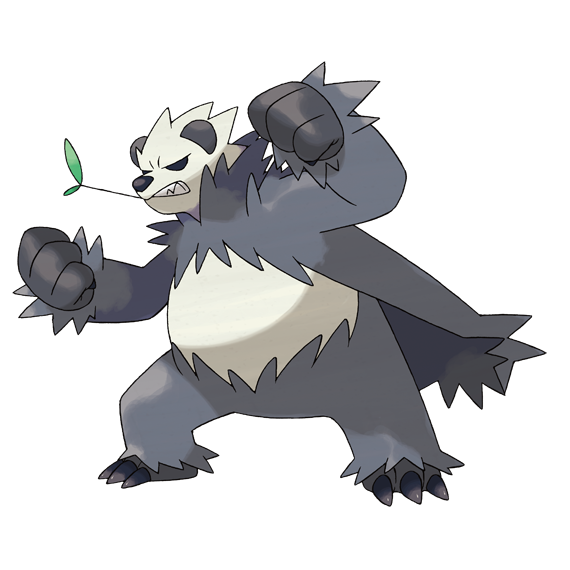

- **種族**: ゴロンダ
- **性別・年齢・学年等**: （詳細不明）。運動部男子コンビの一人とされる
- **立場・職業**: 運動部男子コンビとして春の学生オープントーナメント大会に出場
- **外見**: （詳細不明）
- **性格**: カイリキーと共にニンフィアとエンニュートを見て鼻の下を伸ばした（第05巻ターン120）
- **口調の特徴**: （詳細不明）
- **物語での役割・見せ場**: カイリキーとのペアで大会1回戦の相手で、試合時間わずか3秒で敗北。第06巻ターン126では大会初戦の相手として映像内で言及される（どちらの選手の相手かは詳細不明）。第05巻ターン123の体育会バトル部部員ゴロンダと同一かどうかは（詳細不明）
- **初登場**: 第05巻 ターン120
- **関係のあるキャラ**: カイリキー（1回戦のペア相手）、ニンフィア、エンニュート（1回戦の対戦相手）

### メタグロス

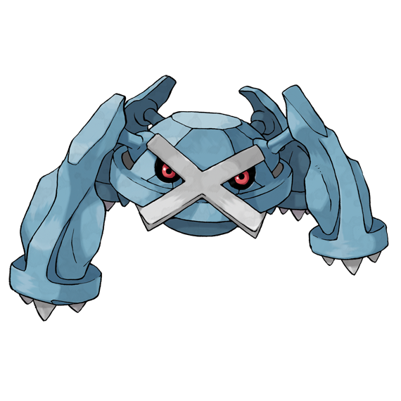

- **種族**: メタグロス
- **性別・年齢・学年等**: （詳細不明）
- **立場・職業**: 体育会バトル部（ジョウト大）レギュラー
- **外見**: （詳細不明）
- **性格**: （詳細不明）
- **口調の特徴**: （詳細不明）
- **物語での役割・見せ場**: ガブリアスとのペアで大会ベスト8（準々決勝）の相手。スキンハイボ解禁のニンフィアたちに敗北（第05巻ターン121）
- **初登場**: 第05巻 ターン121
- **関係のあるキャラ**: ガブリアス（ベスト8のペア相手）、ニンフィア、エンニュート（ベスト8の対戦相手）

### ガブリアス

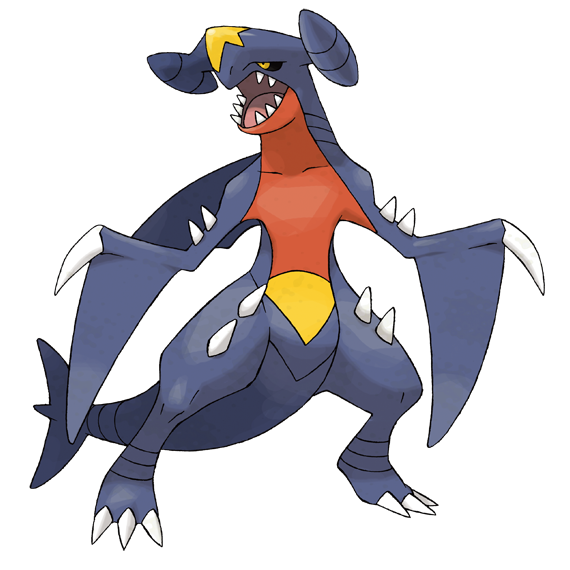

- **種族**: ガブリアス
- **性別・年齢・学年等**: （詳細不明）
- **立場・職業**: 体育会バトル部（ジョウト大）レギュラー
- **外見**: （詳細不明）
- **性格**: （詳細不明）
- **口調の特徴**: （詳細不明）
- **物語での役割・見せ場**: メタグロスとのペアで大会ベスト8（準々決勝）の相手。エンニュートの『アシッドボム』で特防を下げられてからの2発目のスキンハイボで粉砕され敗北（第05巻ターン121）
- **初登場**: 第05巻 ターン121
- **関係のあるキャラ**: メタグロス（ベスト8のペア相手）、ニンフィア、エンニュート（ベスト8の対戦相手）

### ヤレユータン

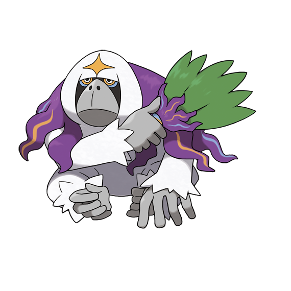

- **種族**: ヤレユータン
- **性別・年齢・学年等**: （詳細不明）
- **立場・職業**: 工学部のデータ解析サークル所属の知略派ペアの一人
- **外見**: （詳細不明）
- **性格**: （詳細不明）
- **口調の特徴**: （詳細不明）
- **物語での役割・見せ場**: コータスとのペアで大会準決勝の相手。「トリックルーム＋噴火（ふんか）＋さいはい」の凶悪ギミックを使い1ターン目にトリックルームを決めたが、2ターン目にエンニュートの『アンコール』で『トリックルーム』を再発動させられ時空を解除（トリル返し）され、3ターン目に決着し敗北（第05巻ターン122）
- **初登場**: 第05巻 ターン122
- **関係のあるキャラ**: コータス（準決勝のペア相手）、ニンフィア、エンニュート（準決勝の対戦相手）

### コータス

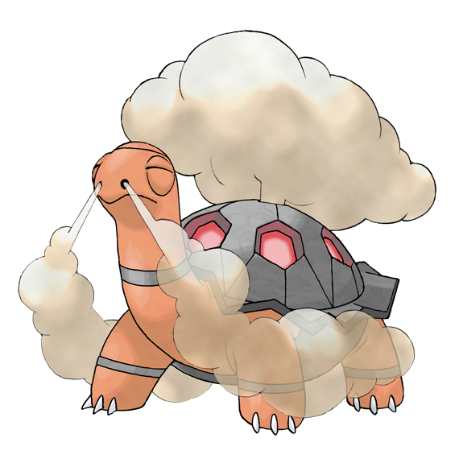

- **種族**: コータス
- **性別・年齢・学年等**: （詳細不明）
- **立場・職業**: 工学部のデータ解析サークル所属の知略派ペアの一人
- **外見**: （詳細不明）
- **性格**: （詳細不明）
- **口調の特徴**: （詳細不明）
- **物語での役割・見せ場**: ヤレユータンとのペアで大会準決勝の相手で、ギミックの噴火役。準決勝ではその『ふんか』をニンフィアが『まもる』で防ぎ、エンニュートが『きあいのタスキ』で耐えた（第05巻ターン122）
- **初登場**: 第05巻 ターン122
- **関係のあるキャラ**: ヤレユータン（準決勝のペア相手）、ニンフィア、エンニュート（準決勝の対戦相手）

### サーフゴー

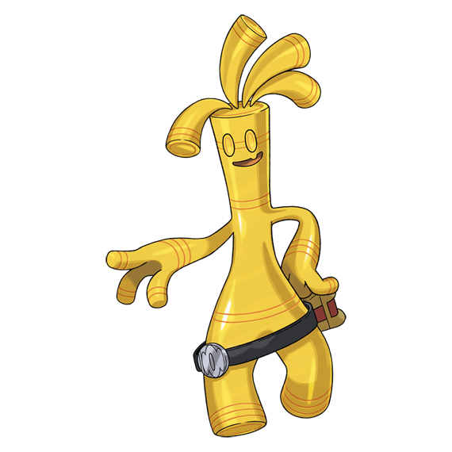

- **種族**: サーフゴー
- **性別・年齢・学年等**: （詳細不明）
- **立場・職業**: カントー大学体育会バトル部主将ペアの一人。他大学からの招待参戦。現役学生公式リーグトップ10に入る全国ランカー
- **外見**: （詳細不明）
- **性格**: （詳細不明）
- **口調の特徴**: （詳細不明）
- **物語での役割・見せ場**: ボーマンダとのペアで大会決勝の相手。使用技は『ゴールドラッシュ』。2ターン目にニンフィアを赤ゲージ寸前まで削ったが、エンニュートの渾身の『オーバーヒート』で大ダメージを受け、最後はニンフィアの最大出力『ハイパーボイス』でボーマンダと同時に撃破され大逆転負け（第05巻ターン122）。第06巻ではエンニュートの『オーバーヒート』で焼き払われた相手として言及される
- **初登場**: 第05巻 ターン122
- **関係のあるキャラ**: ボーマンダ（決勝のペア相手）、ニンフィア、エンニュート（決勝の対戦相手）

### ボーマンダ

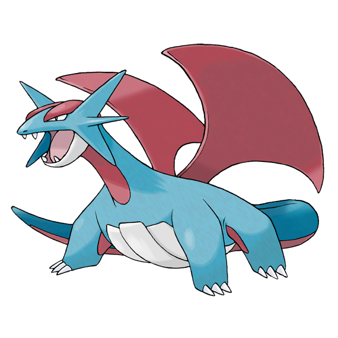

- **種族**: ボーマンダ
- **性別・年齢・学年等**: （詳細不明）
- **立場・職業**: カントー大学体育会バトル部主将ペアの一人。他大学からの招待参戦。現役学生公式リーグトップ10に入る全国ランカー
- **外見**: （詳細不明）
- **性格**: （詳細不明）
- **口調の特徴**: （詳細不明）
- **物語での役割・見せ場**: サーフゴーとのペアで大会決勝の相手。特性は『いかく』。使用技は『おいかぜ』『ダブルウイング』。『ダブルウイング』でエンニュートを戦闘不能にし2対1まで追い込んだが、最後はニンフィアの最大出力『ハイパーボイス』でサーフゴーと同時に撃破され敗北（第05巻ターン122）。第06巻ではニンフィアの決勝の対戦相手として映像内で言及される
- **初登場**: 第05巻 ターン122
- **関係のあるキャラ**: サーフゴー（決勝のペア相手）、エンニュート（『ダブルウイング』で戦闘不能にした相手）、ニンフィア（決勝の対戦相手）

### サーナイト

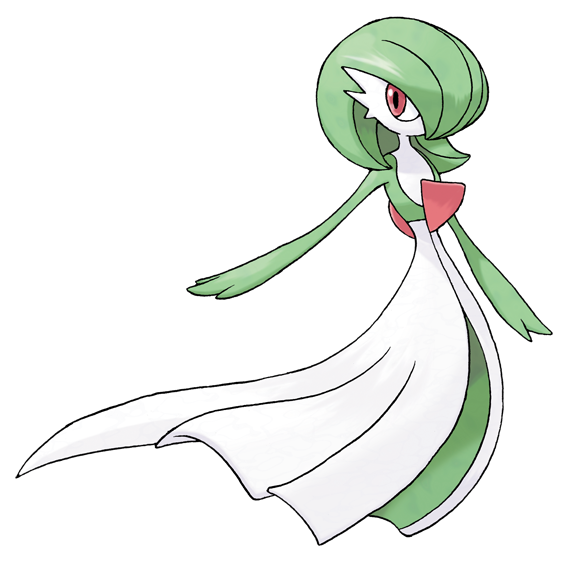

- **種族**: サーナイト
- **性別・年齢・学年等**: （詳細不明）
- **立場・職業**: 大会シングル部門の出場者（所属は詳細不明）。『こだわりスカーフ』持ち
- **外見**: （詳細不明）
- **性格**: （詳細不明）
- **口調の特徴**: （詳細不明）
- **物語での役割・見せ場**: 第05巻ターン121で言及のみ。スカーフ持ちで初手で奇襲し、ルカリオをベスト16敗退させた。第06巻でもルカリオを破った相手として言及される。本人の直接の登場・台詞はなし
- **初登場**: 第05巻 ターン121（言及のみ）
- **関係のあるキャラ**: ルカリオ（シングル部門で破った対戦相手）

### バシャーモ

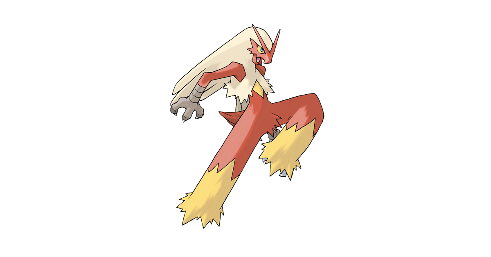

- **種族**: バシャーモ
- **性別・年齢・学年等**: （詳細不明）
- **立場・職業**: 体育会バトル部（ジョウト大）の男子部員
- **外見**: （詳細不明）
- **性格**: （詳細不明）
- **口調の特徴**: （詳細不明）
- **物語での役割・見せ場**: 第05巻ターン123でゴロンダ、カイリキーと共に構内でエンニュート先輩を勧誘したが、色気と投げキッスで撃沈し、勧誘は失敗した
- **初登場**: 第05巻 ターン123
- **関係のあるキャラ**: ゴロンダ、カイリキー（共に勧誘に現れた部員同士。1回戦の運動部男子コンビと同一の個体かどうかは詳細不明）、エンニュート（勧誘相手）

### フシギソウ

- **種族**: フシギソウ
- **性別・年齢・学年等**: 男子学生。ジョウト大学薬学部（学年は詳細不明）
- **立場・職業**: 薬学部の男子学生。エンニュートと同じ実験班
- **外見**: （詳細不明）
- **性格**: （詳細不明）
- **口調の特徴**: （詳細不明）
- **物語での役割・見せ場**: 第06巻ターン124でエンニュートにからかわれ、ビーカーを倒しかけた
- **初登場**: 第06巻 ターン124（初登場かどうかはノートに明記なし）
- **関係のあるキャラ**: エンニュート（同じ実験班。からかわれた相手）

### ミミロップのお姉ちゃん

- **種族**: ミミロップ（なつき進化のポケモン）
- **性別・年齢・学年等**: 女性（推測）。ミミロップの姉
- **立場・職業**: ニンフィアの友人
- **外見**: （詳細不明）
- **性格**: （詳細不明）
- **口調の特徴**: （詳細不明）
- **物語での役割・見せ場**: 言及のみ・未登場（第03巻ターン75）。なつき進化のポケモンの例として名前が挙がった
- **初登場**: （登場なし。第03巻 ターン75で言及のみ）
- **関係のあるキャラ**: ミミロップ（妹（推測））、ニンフィア（友人）

### クラスの女の子たち

- **種族**: （詳細不明）
- **性別・年齢・学年等**: 女性たち。チラーミィのクラスメイト（個人名は詳細不明）
- **立場・職業**: チラーミィのクラスメイト（集団）
- **外見**: （詳細不明）
- **性格**: （詳細不明）
- **口調の特徴**: （詳細不明）
- **物語での役割・見せ場**: 第05巻ターン109〜112で言及。バレンタイン（4月14日）にチラーミィへチョコやクッキーを贈った子たち。チラーミィが持ち帰った合計9個のうち、ニンフィアによる分類（ニンフィアチェック）で義理・友チョコ4個、本命チョコ5個と判定された。第06巻で本命5個の贈り主がエモンガ、パチリス、ロコン、アマカジ、マリルであることが判明した
- **初登場**: 第05巻 ターン109（集団として言及）
- **関係のあるキャラ**: チラーミィ（チョコを贈った相手）、ニンフィア（チョコを分類し、対抗して特大本命チョコを用意した）

### ミハイ

- **種族**: （詳細不明）。『エースコンバット』ゲーム内の敵エースで、機体はX-02S。ポケモン世界の実在の人物ではなく、ゲーム内キャラクターとしてのみ言及される
- **性別・年齢・学年等**: （詳細不明）
- **立場・職業**: 『エースコンバット』の敵エース
- **外見**: （詳細不明）
- **性格**: （詳細不明）
- **口調の特徴**: （詳細不明）
- **物語での役割・見せ場**: 第01巻ターン14〜15、ミッション18『Lost Kingdom』・難易度ACEでチラーミィのF-22Aラプターと対戦。レールガンを背負った漆黒の実験機『X-02S』に搭乗し、重力を無視したような超機動（PSM）で戦う本作屈指の強敵。ミサイル1発を囮にPSM（超機動）を誘われ、減速したところを機関砲で撃破された
- **初登場**: 第01巻 ターン14（ゲームプレイ内。撃破はターン15）
- **関係のあるキャラ**: チラーミィ（ゲーム内で対戦し撃破される相手）

### ソル隊

- **種族**: （詳細不明）。『エースコンバット』ゲーム内の敵部隊。ポケモン世界の実在の人物ではなく、ゲーム内存在としてのみ言及される
- **性別・年齢・学年等**: （詳細不明）
- **立場・職業**: 『エースコンバット』のミッション18に登場する敵の精鋭部隊
- **外見**: （詳細不明）
- **性格**: （詳細不明）
- **口調の特徴**: （詳細不明）
- **物語での役割・見せ場**: 言及のみ（第01巻ターン15）。地上目標パートの後に登場し、チラーミィのF-22Aラプターに「ツンツン」あしらわれて退けられた
- **初登場**: 第01巻 ターン15（ゲームプレイ内・言及のみ）
- **関係のあるキャラ**: チラーミィ（ゲーム内で対戦した相手）、ミハイ（同じミッション18に登場する敵エース）

### マクロ経済学の老教授

- **種族**: （詳細不明）
- **性別・年齢・学年等**: 老齢（詳細不明）
- **立場・職業**: ジョウト大学でマクロ経済学の講義を担当する教授
- **外見**: （詳細不明）
- **性格**: （詳細不明）
- **口調の特徴**: （詳細不明）
- **物語での役割・見せ場**: 言及のみ（第01巻ターン26）。大講義室で黒板に需要・供給曲線の図を描いて講義した。その図は、同行していたチラーミィのお絵描きで戦闘機や巨大ロボットに「魔改造」される素材になった
- **初登場**: 第01巻 ターン26（言及のみ）
- **関係のあるキャラ**: ニンフィア（講義の受講生）、チラーミィ（講義に同行し、黒板の図を魔改造した）

### SYLVEON

- **種族**: （詳細不明）。ニンフィアの脳内に現れる自律人工知能として描写される（実在の人物か比喩的表現かは詳細不明）
- **性別・年齢・学年等**: （詳細不明）
- **立場・職業**: 自律人工知能。3人格（理性・母性・本能）を持つ
- **外見**: （詳細不明）
- **性格**: （詳細不明）。3人格は理性・母性・本能
- **口調の特徴**: （詳細不明）
- **物語での役割・見せ場**: 第01巻ターン36で、ニンフィアの脳内緊急会議で議論し、全会一致で「全力で愛でる」を可決した。第02巻でも脳内議事堂／脳内スパコンとして思考描写に登場する
- **初登場**: 第01巻 ターン36
- **関係のあるキャラ**: ニンフィア（脳内の存在）

### リオレウス

- **種族**: （詳細不明）。『モンスターハンター』のゲーム内モンスター
- **性別・年齢・学年等**: （詳細不明）
- **立場・職業**: モンハンのクエスト対象
- **外見**: （詳細不明）
- **性格**: （詳細不明）
- **口調の特徴**: （詳細不明）
- **物語での役割・見せ場**: ゲーム内登場（第03巻ターン77・78）。エーフィを2回力尽きさせ（2乙）あと1回で失敗という瀬戸際まで追い込んだが、4匹に討伐成功された
- **初登場**: 第03巻 ターン77・78（ゲーム内）
- **関係のあるキャラ**: ニンフィア、チラーミィ、ブラッキー、エーフィ（モンハンで討伐に挑んだ4匹）

### アルセウス

- **種族**: アルセウス
- **性別・年齢・学年等**: （詳細不明）
- **立場・職業**: （詳細不明）
- **外見**: （詳細不明）
- **性格**: （詳細不明）
- **口調の特徴**: （詳細不明）
- **物語での役割・見せ場**: 第06巻ターン125で、フライゴンとデンリュウの幸運を「采配」と表現する文脈で地の文に名前のみ登場。具体的な登場・関与はなし
- **初登場**: 第06巻 ターン125（地の文に言及のみ）
- **関係のあるキャラ**: （詳細不明）

### ジュンサーさん

- **種族**: （詳細不明）
- **性別・年齢・学年等**: （詳細不明）
- **立場・職業**: （詳細不明）
- **外見**: （詳細不明）
- **性格**: （詳細不明）
- **口調の特徴**: （詳細不明）
- **物語での役割・見せ場**: 第05巻ターン107で「事案として通報されかねない」という文脈で名前のみ言及。本人の登場はなし
- **初登場**: 第05巻 ターン107（名前のみ言及）
- **関係のあるキャラ**: （詳細不明）

---

## 収録について

- 本図鑑の収録キャラ数：**54**（集団として扱った「クラスの女の子たち」を1件として数えたもの。言及のみ・ゲーム内登場のみのキャラクターも含む）
- 資料ノート第04巻のファイル自体はターン95途中で途切れているが、補完ノート04によりターン96〜102の範囲を補完済み。これに基づき、ガーディとリオルの初登場を第04巻ターン101に修正し、両名の情報を追記した。補完ノート01由来の未収録キャラ（マクロ経済学の老教授、ソル隊）も追加収録した。
